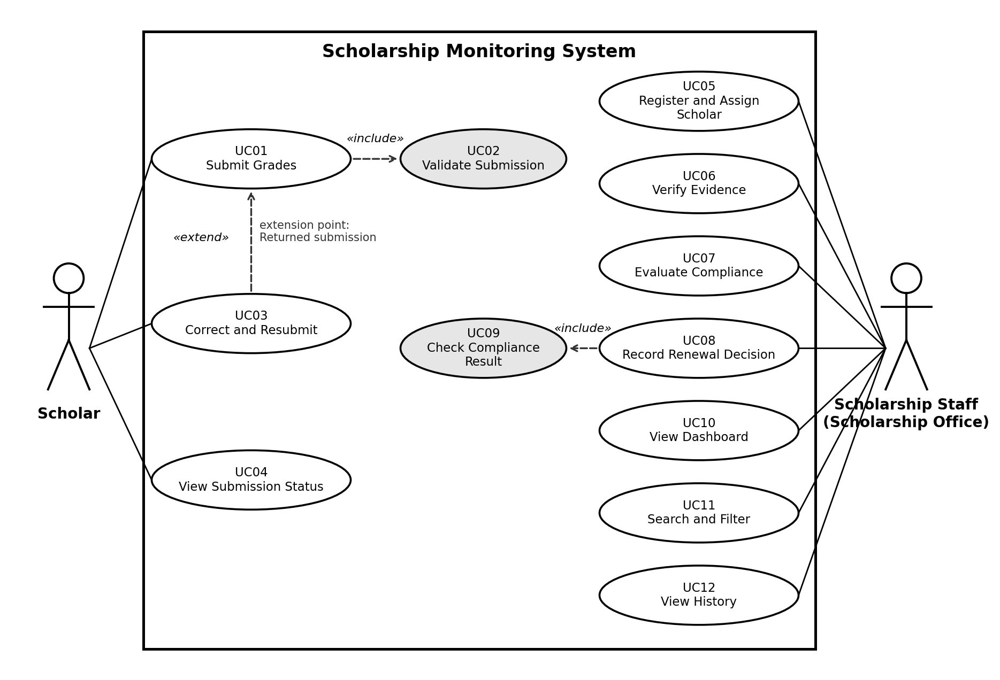

# SAD Midterm Exam
**Student Scholarship Monitoring and Academic Compliance System**

| | |
|---|---|
| **Name** | Meryl D. Soriano |
| **Section** | BSIT 3A |
| **Date** | 10/20/2026 |
| **Exam** | Comprehensive Laboratory Midterm Examination, Section A |

## Test accounts
Credentials for the Scholar and Staff (Scholarship Office) test accounts were supplied privately to the instructor. They are not stored in this repository.

## Setup
Stack: HTML, CSS, and JavaScript with Supabase (Auth, Postgres, row level security, SQL functions).

1. Create a Supabase project. In Authentication > Users, add a scholar user and a staff user (Auto Confirm User ticked), plus a second scholar for the role-isolation test.
2. In the SQL Editor run, in order: `sql/01_schema.sql`, `sql/02_rls.sql`, `sql/03_functions.sql`, `sql/04_seed.sql`. In the seed file, replace each `<...-UUID>` with the matching user's UID.
3. Edit `config.js` and set `SUPABASE_URL` and `SUPABASE_ANON_KEY` (the anon key only; never the service-role key).
4. Run locally with the VS Code Live Server extension, or `python -m http.server 8000` and open http://localhost:8000.

**Environment variable names:** `SUPABASE_URL`, `SUPABASE_ANON_KEY` (set in `config.js`).

## Design notes
- Access control is enforced by row level security. Scholars read only their own rows. Staff have no direct UPDATE on submissions, only the functions `verify_submission`, `evaluate_submission`, and `decide_renewal`.
- Thresholds come from the `programs` table. The deadline is 2026-10-30 17:00 Asia/Manila, and the exact deadline is on time.
- Verification status, compliance result, and renewal decision are separate columns.
- Assumption: a resubmission keeps the original submission timestamp.

## Known defects
List any defects found during testing here. Test results are in `docs/TEST_RESULTS.md`.

---

# Part I: Analysis and Design

## A1. Investigation and planning

### Problem statement

The Scholarship Office administers Merit Scholar and Community Scholar grants using spreadsheets, email attachments, and paper grade records. This causes duplicate semester entries, unverified grades, missed deadlines, and inconsistent renewal decisions. Scholars cannot see whether their submission was received, verified, or returned for correction, and renewals are delayed.

### Problem, cause, and effect

| **\#** | **Cause**                                           | **Effect**                              | **System response**                                                             |
|--------|-----------------------------------------------------|-----------------------------------------|---------------------------------------------------------------------------------|
| 1      | Spreadsheets and email attachments hold the records | Duplicate semester entries              | One submission per scholar, year, and semester, enforced by the database (FR05) |
| 2      | No verification step before grades are used         | Unverified grades drive decisions       | Staff must mark evidence Verified before evaluation (FR07, FR09)                |
| 3      | Deadlines are tracked by hand                       | Late or missed submissions go unnoticed | Server timestamp compared with the program deadline (FR10)                      |
| 4      | Policy is checked manually, case by case            | Inconsistent renewal decisions          | Thresholds read from the program record; reasons displayed (FR09, FR11)         |

### Scope

- Scholar and Scholarship Staff roles with sign-in and enforced access.

- Semester grade submission, verification (Verified or Returned), correction and resubmission.

- Policy compliance evaluation for two programs, renewal decision, dashboard, search and filter, and audit history.

### Exclusions

- Live Registrar API; the Registrar remains the source of official grades and the system never alters them.

- Payment release, SMS notifications, machine learning, full appeal workflow, and policy exceptions.

### Development tasks

| **ID** | **Task**                                | **Output**                                             |
|--------|-----------------------------------------|--------------------------------------------------------|
| T1     | Schema, keys, programs, access policies | Tables, row level security, test accounts              |
| T2     | Assignment and grade submission         | Register scholar form, submission form with validation |
| T3     | Verification, evaluation, and renewal   | Database functions and staff screens                   |
| T4     | Dashboard, history, and testing         | Counts, search, filters, TC01 to TC10 results          |

### Risks and responses

| **ID** | **Risk**                                                                         | **Response**                                                                         |
|--------|----------------------------------------------------------------------------------|--------------------------------------------------------------------------------------|
| R1     | Access policies are misconfigured and one scholar reads another scholar’s record | Enforce access in the database, and test with two real scholar accounts early (TC08) |
| R2     | Time overrun during the 150-minute build                                         | Build the mandatory path first and leave appearance for last                         |

## A2. Stakeholders and elicitation

| **Stakeholder**         | **Interest**                                             | **Actual actor?**                                                  |
|-------------------------|----------------------------------------------------------|--------------------------------------------------------------------|
| Scholar                 | Submits grades and tracks verification and renewal       | Yes. Signs in and uses the system.                                 |
| Scholarship Staff       | Verifies evidence, evaluates compliance, decides renewal | Yes. Signs in and uses the system.                                 |
| Registrar               | Holds official grades                                    | No. External source of official grades with no role in the system. |
| Scholarship Office Head | Oversees consistent renewal outcomes                     | No. Receives results through staff and the dashboard.              |

### Elicitation questions

1.  What evidence do you accept as proof of grades today, and how do you check that it is genuine? (verification)

2.  How are deadlines announced, and what happens when a scholar submits late? (deadlines)

3.  When have exceptions to the scholarship policy been granted, and who approved them? (policy exceptions)

4.  Which people should see or change which records, and should scholars see each other’s results? (access)

5.  What do you do when a grade document is unreadable or does not match the entered summary? (verification)

6.  Which reports do you prepare each semester, and which counts do you need to see? (reports)

## A3. Requirements and business rules

### Functional requirements

| **ID** | **Requirement**                                                                                                                                                                              | **Rules**  | **Test**     |
|--------|----------------------------------------------------------------------------------------------------------------------------------------------------------------------------------------------|------------|--------------|
| FR01   | A user signs in with email and password, and the system applies the role (Scholar or Staff) stored in the user’s profile.                                                                    | BR01       | TC08         |
| FR02   | A scholar can view only their own submissions and history; the database returns no rows for other scholars.                                                                                  | BR01       | TC08         |
| FR03   | Staff register a scholar and assign exactly one of two stored program records (Merit Scholar or Community Scholar).                                                                          | BR03       | Demo         |
| FR04   | A scholar submits academic year, semester, GWA, enrolled units, failed, incomplete, and dropped counts, and a grade-document reference; the system records a server timestamp.               | BR04       | TC01         |
| FR05   | The system rejects a second submission for the same scholar, academic year, and semester with a clear message.                                                                               | BR04       | TC07         |
| FR06   | The system rejects a GWA outside 1.00 to 5.00, a negative or non-integer count, and an empty evidence reference.                                                                             | BR04       | TC07         |
| FR07   | Staff mark a submission Verified or Returned; a reason is required when returning.                                                                                                           | BR02       | TC09         |
| FR08   | The owner can correct a Returned submission; the corrected record returns to Pending verification and its history is kept.                                                                   | BR02       | TC09         |
| FR09   | The system evaluates only Verified submissions, using the thresholds of the scholar’s program, and lists each failed check as a reason.                                                      | BR03, BR06 | TC01 to TC06 |
| FR10   | A submission after 2026-10-30 17:00 Asia/Manila is late and produces a deficiency; a submission at the exact deadline is on time.                                                            | BR06       | TC01, TC05   |
| FR11   | Staff record Approved or Held with a note; Approved requires a Compliant result and scholars cannot change the decision.                                                                     | BR05       | TC06, TC10   |
| FR12   | Staff see totals of assigned scholars, pending verification, compliant, and with deficiency for a chosen semester, and can search by student ID or name and filter by program or compliance. | BR01       | Demo         |
| FR13   | The system logs every verification, evaluation, renewal decision, and resubmission with actor, timestamp, and note.                                                                          | BR02, BR05 | TC09         |

### Non-functional requirements

| **ID** | **Quality**  | **Measurable requirement**                                                                                                                                                   |
|--------|--------------|------------------------------------------------------------------------------------------------------------------------------------------------------------------------------|
| NFR01  | Performance  | A valid submission is saved and confirmed within 3 seconds on a normal connection.                                                                                           |
| NFR02  | Persistence  | 100% of saved submissions and history entries remain after a page refresh or a new sign-in.                                                                                  |
| NFR03  | Security     | A scholar’s query for another scholar’s records returns 0 rows, 100% of staff-only function calls by a scholar are rejected, and no service-role key appears in client code. |
| NFR04  | Auditability | 100% of verification, evaluation, renewal, and resubmission changes are logged with actor and timestamp.                                                                     |

### Business rules

| **ID** | **Rule**                                                                                                                                                                                                                                                                                                         |
|--------|------------------------------------------------------------------------------------------------------------------------------------------------------------------------------------------------------------------------------------------------------------------------------------------------------------------|
| BR01   | Role access: a scholar sees only their own submissions; staff can see all submissions. Access is enforced in the database, not by hiding buttons.                                                                                                                                                                |
| BR02   | Verification: only staff verify evidence. A Returned status needs a reason, and a correction returns the record to Pending.                                                                                                                                                                                      |
| BR03   | Policy selection: every scholar is assigned one program, and evaluation reads thresholds from that program record rather than from code.                                                                                                                                                                         |
| BR04   | Duplicate prevention: one submission per scholar, academic year, and semester. GWA must be 1.00 to 5.00 inclusive; counts and units are non-negative integers.                                                                                                                                                   |
| BR05   | Renewal authority: only staff record Approved or Held. Approval requires a Compliant evaluation, and staff cannot approve a record With Deficiency.                                                                                                                                                              |
| BR06   | Evaluation gate and deadline: only Verified evidence can be evaluated. The deadline is 2026-10-30 17:00 Asia/Manila; the exact deadline is on time and later is late. Submission status, compliance result, and renewal decision are kept separate, and a deficiency never disqualifies a scholar automatically. |

## A4. UML use case modeling

Authentication is a precondition for every use case, so it is not drawn as an include relationship.

### User goals

| **ID** | **Goal**                    | **Actor** | **Description**                                    |
|--------|-----------------------------|-----------|----------------------------------------------------|
| UC01   | Submit Grades               | Scholar   | Send a semester summary with an evidence reference |
| UC03   | Correct and Resubmit        | Scholar   | Fix a returned submission                          |
| UC04   | View Submission Status      | Scholar   | See verification, compliance, and renewal status   |
| UC05   | Register and Assign Scholar | Staff     | Create a scholar profile and assign a program      |
| UC06   | Verify Evidence             | Staff     | Mark evidence Verified or Returned with a reason   |
| UC07   | Evaluate Compliance         | Staff     | Check a verified submission against program policy |
| UC08   | Record Renewal Decision     | Staff     | Approve or hold renewal with a note                |
| UC10   | View Dashboard              | Staff     | See semester totals                                |
| UC11   | Search and Filter           | Staff     | Find scholars by ID, name, program, or compliance  |
| UC12   | View History                | Staff     | Read the audit log of a submission                 |

### Include and extend relationships

| **Relationship**                                             | **Type** | **Justification**                                                                                                                                                                                             |
|--------------------------------------------------------------|----------|---------------------------------------------------------------------------------------------------------------------------------------------------------------------------------------------------------------|
| UC01 Submit Grades to UC02 Validate Submission               | Include  | Validation runs on every submission, so it is mandatory reused behavior. The arrow points from the including use case to the included one.                                                                    |
| UC08 Record Renewal Decision to UC09 Check Compliance Result | Include  | Every decision must check the stored compliance result first, because approval is allowed only for a Compliant record (BR05).                                                                                 |
| UC03 Correct and Resubmit to UC01 Submit Grades              | Extend   | Correction applies only when evidence was Returned, so it is conditional added behavior. The extension point is “Returned submission”, and the arrow points from the extending use case to the base use case. |

## A5. Detailed use cases and data design

### UC01 Submit Grades

<table>
<colgroup>
<col style="width: 21%" />
<col style="width: 78%" />
</colgroup>
<tbody>
<tr class="odd">
<td><strong>Actor</strong></td>
<td>Scholar</td>
</tr>
<tr class="even">
<td><strong>Trigger</strong></td>
<td>The scholar opens the submission form and presses Submit grades.</td>
</tr>
<tr class="odd">
<td><strong>Preconditions</strong></td>
<td>The scholar is signed in and linked to a profile.</td>
</tr>
<tr class="even">
<td><strong>Main flow</strong></td>
<td><ol type="1">
<li>
The scholar enters the academic year and selects the semester.
</li>
<li>
The scholar enters GWA, enrolled units, and the failed, incomplete, and dropped counts.
</li>
<li>
The scholar enters the grade-document reference.
</li>
<li>
The scholar presses Submit grades.
</li>
<li>
The system validates the input (include UC02).
</li>
<li>
The system checks that no submission exists for the same scholar, year, and semester.
</li>
<li>
The system saves the record with a server timestamp, verification Pending, compliance Not Evaluated, and renewal None.
</li>
<li>
The system confirms and refreshes My submissions.
</li>
</ol></td>
</tr>
<tr class="odd">
<td><strong>Alternative flows</strong></td>
<td><ol type="1">
<li>
A1 (step 6): the existing submission is Returned. The system treats the entry as a correction (UC03), updates the values, resets verification to Pending, keeps the original timestamp, and logs the resubmission.
</li>
</ol></td>
</tr>
<tr class="even">
<td><strong>Exception flows</strong></td>
<td><ol type="1">
<li>
E1 (step 5): GWA is outside 1.00 to 5.00, or a count is negative or not a whole number. The system rejects the entry and saves nothing.
</li>
<li>
E2 (step 5): the evidence reference is empty. The system rejects the entry.
</li>
<li>
E3 (step 6): a submission already exists and is not Returned. The system shows “You already submitted this semester.”
</li>
<li>
E4: the session has expired or the database is unreachable. The system shows an error and saves nothing.
</li>
</ol></td>
</tr>
<tr class="odd">
<td><strong>Postconditions</strong></td>
<td>The submission is stored as Pending verification with a server timestamp and is visible only to its owner and to staff.</td>
</tr>
<tr class="even">
<td><strong>Linked IDs</strong></td>
<td>FR02, FR04, FR05, FR06, FR08; BR01, BR04</td>
</tr>
</tbody>
</table>

### UC07 Evaluate Compliance

<table>
<colgroup>
<col style="width: 21%" />
<col style="width: 78%" />
</colgroup>
<tbody>
<tr class="odd">
<td><strong>Actor</strong></td>
<td>Scholarship Staff</td>
</tr>
<tr class="even">
<td><strong>Trigger</strong></td>
<td>Staff press Evaluate on a submission row.</td>
</tr>
<tr class="odd">
<td><strong>Preconditions</strong></td>
<td>Staff are signed in. The submission is Verified and the scholar is assigned to a program.</td>
</tr>
<tr class="even">
<td><strong>Main flow</strong></td>
<td><ol type="1">
<li>
Staff select Evaluate on a submission.
</li>
<li>
The system confirms the verification status is Verified.
</li>
<li>
The system loads the scholar’s assigned program record with its thresholds and deadline.
</li>
<li>
The system checks GWA against the maximum (equal is allowed).
</li>
<li>
The system checks enrolled units against the minimum.
</li>
<li>
The system checks failed, incomplete, and dropped counts against the allowed numbers.
</li>
<li>
The system compares the submission timestamp with the deadline (the exact deadline is on time).
</li>
<li>
If every check passes the result is Compliant; otherwise it is With Deficiency with one reason per failed check.
</li>
<li>
The system stores the result and reasons and writes an audit entry with actor and time.
</li>
<li>
The system displays the result and reasons.
</li>
</ol></td>
</tr>
<tr class="odd">
<td><strong>Alternative flows</strong></td>
<td><ol type="1">
<li>
A1 (step 1): the submission was evaluated before. The new result replaces the old one, and the earlier result stays in the history.
</li>
</ol></td>
</tr>
<tr class="even">
<td><strong>Exception flows</strong></td>
<td><ol type="1">
<li>
E1 (step 2): the submission is Pending or Returned. The system blocks evaluation with a message.
</li>
<li>
E2 (step 3): the scholar has no program. The system shows an error.
</li>
<li>
E3: the caller is not staff. The database rejects the call with “Staff only”.
</li>
</ol></td>
</tr>
<tr class="odd">
<td><strong>Postconditions</strong></td>
<td>The compliance result and deficiency reasons are stored and logged. Verification status and award status are unchanged; renewal stays a separate staff decision.</td>
</tr>
<tr class="even">
<td><strong>Linked IDs</strong></td>
<td>FR09, FR10, FR13; BR03, BR06</td>
</tr>
</tbody>
</table>

### Entity relationship diagram

Cardinalities: a profile has 0 or 1 assignment (staff have none, scholars exactly one); a program governs 0 or more assignments; a profile has 0 or more submissions and 0 or more audit entries as actor; a submission has 0 or more audit entries. Submission status, compliance result, and renewal decision are separate columns, so a record can be Verified, With Deficiency, and still keep an Active award.

### Data design notes

- Records are linked by stable identifiers (uuid and serial keys), never by name.

- SUBMISSIONS has a unique constraint on scholar, academic year, and semester, which prevents duplicates.

- Thresholds and the deadline live in PROGRAMS, so changing a policy does not change code.

## A6. Traceability

| **FR** | **Actor** | **Use case**                 | **Rule**   | **Screen or function**                                    | **Test and expected result**                                                |
|--------|-----------|------------------------------|------------|-----------------------------------------------------------|-----------------------------------------------------------------------------|
| FR02   | Scholar   | UC04 View Submission Status  | BR01       | Row level security on submissions and v_submissions       | TC08: a scholar reading another scholar’s record gets 0 rows                |
| FR05   | Scholar   | UC01 Submit Grades           | BR04       | Unique constraint on submissions; Submit grades form      | TC07: a duplicate semester is rejected with a clear message                 |
| FR09   | Staff     | UC07 Evaluate Compliance     | BR03, BR06 | evaluate_submission(); Evaluate button and reasons column | TC02: record 02 is With Deficiency with a GWA reason                        |
| FR11   | Staff     | UC08 Record Renewal Decision | BR05       | decide_renewal(); Approve and Hold buttons                | TC10: Approve works on a Compliant record and is refused on a deficient one |

### Planned requirements not implemented

All of FR01 to FR13 are implemented. The following are outside the examination scope and are not built: Registrar integration, payments, SMS notices, appeals, policy exceptions, a screen for editing program thresholds (they are changed in the database), and staff editing of a scholar’s submitted values.
